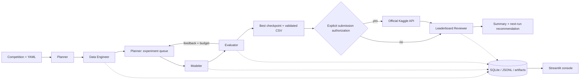

# ⚡ KaggleSlayer

### Autonomous Multi-Agent ML Competition Team

KaggleSlayer turns tabular competition CSVs into measured experiments, trained checkpoints and a validated submission file. Five specialized agents collaborate through typed state, use cross-validation to guide improvements, and record decisions in SQLite and JSONL. A Streamlit console exposes the actual activity and results.

The goal is competitive performance with minimal competition-specific code. **Top 20% is an aspiration, never a promised result.** The CLI defaults to the agentic configuration, using an LLM coordinator and specialist sessions to choose executable actions, observe measured results, and revise the pipeline. Configure the LLM provider/model/key before running. Offline deterministic operation remains available with `--execution-mode deterministic`. Upload permission belongs to trusted runtime policy.

## LLM-directed agentic mode

```bash
# Configure the existing KS_LLM_PROVIDER, KS_LLM_MODEL and KS_LLM_API_KEY first.
uv run python -m kaggle_slayer run --competition titanic
# Offline demonstration: fake LLM responses, real model training and validated predictions.
uv run python -m examples.scripted_swarm --output artifacts/swarm-example
```

The coordinator delegates to data/validation, pipeline/modeling, evaluation, and submission specialists as needed. Agents select supported preprocessing, feature operations, model parameters, trials, ensembles and stopping through validated action/tool contracts. Independent LLM tasks and experiments can run concurrently; a single scheduler reserves resources and commits evidence. Provider failures checkpoint an explicit incomplete outcome. Old runs retain deterministic execution.

See [agentic usage and recovery](docs/agentic-usage.md), [versioned schemas/prompts](docs/contracts/swarm-v1), and [offline execution evidence](evidence/swarm-offline.md). The deterministic workflow below remains available as a separate mode; its optional initial model-ordering advice is a legacy feature.

## Features

- Official Kaggle metadata, authenticated downloads, explicitly authorized single-attempt uploads and submission feedback.
- Binary/multiclass tabular classification and single-target regression, with YAML overrides for ambiguous requirements.
- Linear baseline, Random Forest, LightGBM, CatBoost and XGBoost enabled by default; histogram gradient boosting is also available.
- Fold-fit preprocessing, stratified/K-fold/group/time validation, inner-fold early stopping and bounded Optuna optimization.
- Optional CV-tested voting/averaging of the strongest two distinct model families, inside the same experiment budget.
- Metric-direction handling, overfitting warnings, OOF evidence, model checkpoints, feature importance and strict submission checks.
- Durable decisions, configuration/environment snapshots, data fingerprints, worker timeouts and interrupted-run recovery.
- Dashboard with history, agent/tool timeline, experiment comparisons, actual feedback and artifact downloads.
- Offline tests, synthetic demos, a real public Titanic holdout demo, Docker and uv-based CI.

## Architecture



| Agent | Specialization |
|---|---|
| Competition Planner | Schedules baselines, consumes evaluator feedback and asks Optuna for improvements. Optional LLM advice prioritizes approved families. |
| Data Engineer | Downloads/reads CSVs, resolves schema, audits quality/leakage, creates EDA and fixed splits. |
| Modeling Agent | Fits isolated experiments and persists measured metrics, OOF predictions and full-data checkpoints. |
| Evaluation Agent | Ranks eligible models, rejects weaker candidates, checks overfitting and validates output. |
| Leaderboard Reviewer | Reads run-specific feedback and compares public/local scores. Missing rank and percentile remain unknown. |

The deterministic team uses distinct tools and policies rather than five copies of a prompt. The state machine is deliberately lightweight; LangGraph is not required. See [architecture](docs/architecture.md), [agent contracts](docs/agents.md) and [technical decisions](docs/decisions.md).

## Stack and installation

Python 3.11+, Pydantic, pandas/NumPy, scikit-learn, LightGBM, Optuna, joblib, the official Kaggle API, httpx, SQLite, Streamlit and Plotly. XGBoost/CatBoost are an optional extra. **uv manages Python, environments, dependencies and execution throughout.**

Install [uv](https://docs.astral.sh/uv/getting-started/installation/), open this directory and run:

```bash
uv python install 3.11
uv python pin 3.11
uv sync --locked --extra dev
uv run python -m kaggle_slayer doctor
```

CatBoost and XGBoost are included in the standard installation; no boosting extra is needed. Run `uv sync --locked --extra dev` after updating an existing checkout. The old `boosting` extra is retained as an empty compatibility alias.

Copy `.env.example` to `.env` using your editor. Secrets, datasets, virtual environments and generated runs are ignored by Git. `uv.lock` records core and development dependencies. See [reproducibility](docs/reproducibility.md) for restricted Windows environments and lockfile policy.

## Live execution logging

CLI runs show the active agent, experiment/model, budget position, validation role, fold activity, measured fold scores, refit, model selection and confirmation status. During worker startup or long training, a heartbeat appears every ten seconds with elapsed experiment time and the latest stage. No extra verbosity flag is needed.

Each line has a UTC timestamp and is saved under `artifacts/runs/<run-id>/progress.log`. Structured worker events are saved in each experiment's `progress.jsonl`, while detailed library output stays in `worker.log`. Agent decisions remain in SQLite and `decisions.jsonl`. Raw LLM responses, credentials and raw worker stdout are not streamed to the console. `resume` and `submit` use the same live reporting; `refresh` reports reviewer activity.

## Deterministic mode and legacy initial advice

`KS_LLM_PROVIDER=deterministic` is the default and needs no key or network for local CSV workflows. Every agent still performs specialized work, including feedback-driven tuning.

To configure an endpoint in `.env`:

```dotenv
KS_LLM_PROVIDER=openrouter
KS_LLM_API_KEY=your-own-key
KS_LLM_MODEL=your-selected-model-id
```

Providers: `openrouter`, `groq`, `openai-compatible`, `local`, or `deterministic`. For a local compatible server, use `KS_LLM_PROVIDER=local`, `KS_LLM_BASE_URL=http://localhost:11434/v1` and a model installed on that server. No local model download is automatic. In deterministic mode, invalid/unavailable initial advice falls back to deterministic planning with a warning. Agentic mode never falls back. The legacy initial request sends bounded schema/quality and target aggregates, validation settings, budgets and model capabilities. Column names and target statistics may still be sensitive in that legacy request; agentic context uses opaque feature IDs. Raw rows, category values, class label names, credentials and local paths are excluded. Suggestions cannot change metrics, budgets or submission authorization.

The compact, versioned [initial planner prompt](src/kaggle_slayer/llm/prompts.py) explicitly describes **pre-training** planning: scores are not available yet, and their absence is expected. It requests a brief evidence-based rationale (up to 60 words), allowed-model priorities and at most two actionable dataset risks. Generic missing-CV notices and already-enforced pipeline reminders are discouraged. Context includes aggregate risks and at most eight feature examples spanning missingness/cardinality, compact model contracts and the fixed validation/budget. Truncation is explicit and unknown metadata remains unknown. Python retains the model allowlist, linear-first baseline and experiment policies. There is still one planning request, no new post-baseline LLM reviewer, and no change to output-token limits or reasoning settings. Runs record the prompt version in metadata. Shorter inputs reduce context overhead but cannot guarantee a reasoning model will finish within its output allowance.

To test LLM planning without downloading data or training models:

```bash
uv run python -m kaggle_slayer llm-check
```

This sends **one** request with synthetic context using the configured provider/model and the same output budget as real planning. `KS_LLM_MAX_TOKENS` defaults to 700 and accepts 128–32768. For reasoning models that exhaust 700 tokens before producing JSON, a value such as 4096 leaves more room for the answer. This is a per-request output limit, not a monetary budget. The check may consume provider credits or free-tier quota. It never retries, changes models, or contacts Kaggle. A failed check exits with code 1; deterministic mode reports `disabled` and makes no request. The ordinary `doctor` command does not test LLM requests.

Failures now identify configuration problems, HTTP authentication/credit/rate-limit errors, unsupported JSON mode, timeouts, invalid JSON, truncated output or planning-schema mismatches. Safe diagnostics include provider/model, HTTP status, a category and corrective action. Model runs save these under `metadata.llm_diagnostic` and in an agent decision, visible in the dashboard. Credentials, response bodies, headers, exception text and failed model-output values are excluded. See [LLM troubleshooting](docs/llm-troubleshooting.md).

## Kaggle authentication and rules

Use [Kaggle account settings](https://www.kaggle.com/settings) to configure credentials. Supported official configuration includes `KAGGLE_API_TOKEN`, `KAGGLE_USERNAME` plus `KAGGLE_KEY`, or `~/.kaggle/kaggle.json` (`%USERPROFILE%\.kaggle\kaggle.json` on Windows). `KAGGLE_CONFIG_DIR` can point to a separate credential directory. Never commit credentials.

Open the competition website and manually accept its rules if required. Some competitions restrict eligibility or require notebook execution; this runner does not bypass those restrictions. The server enforces account quotas. KaggleSlayer permits at most one attempted upload per run and never retries an uncertain upload.

```bash
uv run python -m kaggle_slayer doctor --competition titanic --require-kaggle
```

The authenticated check must succeed before an official run can download data. Local CSV execution remains available with `--data-dir`.

## Run a competition

```bash
# Five baselines, broader tuning, an ensemble and finalist checks; no upload by default.
uv run python -m kaggle_slayer run --competition titanic

# Explicitly authorize one upload after training and validation.
uv run python -m kaggle_slayer run --competition titanic --submit

# Raise the row guard for a large competition dataset; the default is 1,000,000.
uv run python -m kaggle_slayer run --competition store-sales-time-series-forecasting --max-rows 4000000 --submit

# The airline dataset fits the default encoded-cell memory guard.
uv run python -m kaggle_slayer run --competition playground-series-s6e10 --submit

# Use official files already downloaded locally.
uv run python -m kaggle_slayer run --competition titanic --data-dir data/titanic --no-submit

# Switch task and metric using the included profile.
uv run python -m kaggle_slayer run --competition house-prices-advanced-regression-techniques --no-submit

# Optional smaller three-family run; ensembles are already enabled by default.
uv run python -m kaggle_slayer run --competition titanic --config configs/ensemble.yaml --no-submit
```

`--max-dense-cells` overrides the default 40-million encoded-cell memory guard. This estimates preprocessing size rather than enforcing an OS memory limit. Dataset row, memory and unresolved-metric failures stop agentic runs with a specific error and corrective option, instead of spending more LLM requests on unchanged constraints. Set a new limit or profile when starting a new run; saved constraints remain immutable.

Source-data size is checked during inspection; candidate-specific encoding, missing indicators and derived features are checked before reserving an experiment and again in the worker. CatBoost uses native feature counts, while ensembles check each member's preprocessing. A candidate rejected before training does not consume an agentic experiment slot and returns the reason and size counts for correction.

Use `uv run python -m kaggle_slayer run --help` for flags. `--profile path.yaml` supplies competition schema/metric overrides; `--config path.yaml` supplies run budgets and model choices. CLI values take precedence. `--max-rows` overrides the default one-million-row CSV limit for large datasets; file-size and memory limits still apply. Defaults: five folds, **12 total experiments**, two CPU threads, a 30-minute scheduling budget and five-minute experiment timeout. Normally this funds five baselines, four tuning trials across the leading three families, one equal-weight ensemble and two finalist confirmations on a second split seed. The planner explores leading families before concentrating remaining trials on the current winner. Failed attempts consume budget; time limits may stop a run early. An explicit `--max-experiments 5` uses all slots for baselines. Saved runs retain their recorded budgets; new behavior is best compared in a fresh run.

CatBoost uses native categorical features; other trees use unscaled, fold-imputed features with numeric missingness indicators, while linear models use scaling. Regression losses follow MAE or squared error where supported; each experiment records its actual training contract and any surrogate/transformed-target mismatch. Ensembles keep independent preprocessing per member and must beat the best single model by more than the configured relative improvement threshold (default 0.1%).

Finalist confirmations freeze hyperparameters and use a second split seed. They are diagnostics, excluded from primary ranking, and do not change selection or trigger more tuning. They reuse labels and **are not an untouched holdout**. Group/time validation is preserved and skips random-seed confirmation. The dashboard exposes stability and aggregate out-of-fold error slices; LLM planning cautions appear in decision history and metadata rather than execution warnings. See [experiment protocol](docs/experiments.md).

An executed cached-data Home Data benchmark improved local MAE from **16,334.15 to 15,539.69** on identical primary folds and data fingerprints. The selected ensemble also beat the single-model finalist on a second split seed. It was **not submitted**, and the train/CV gap remains flagged. See [measured evidence and reproduction](evidence/search-improvements.md); local gains do not guarantee public-score gains.

Another competition can use a profile such as:

```yaml
competition: my-competition
target: outcome
id_column: record_id
task: classification
metric: roc_auc
prediction_kind: probability
train_file: train.csv
test_file: test.csv
sample_file: sample_submission.csv
validation: stratified
```

The runner infers a single train-only target and template identifier when unambiguous. Task inference uses type/cardinality; explicitly override integer-valued regression. Metrics require a known profile, recognized API metadata or YAML. Unresolved relationships/formats produce errors. See [experiment details](docs/experiments.md) for metrics, positive-class conventions and validation choices.

## Inspect, resume and submit a saved result

Replace `RUN_ID` with the ID from an actual run:

```bash
uv run python -m kaggle_slayer runs
uv run python -m kaggle_slayer inspect RUN_ID
uv run python -m kaggle_slayer resume RUN_ID
uv run python -m kaggle_slayer submit RUN_ID
uv run python -m kaggle_slayer refresh RUN_ID
```

`submit RUN_ID` explicitly authorizes one upload of a completed run's validated CSV. It verifies file integrity and refuses fixture/public-demo data or a second attempt. Resume verifies dataset fingerprints and reuses completed experiments; submission permission must be supplied again with `resume --submit`. A completed resume is a no-op; use `submit` to upload a completed no-submit run. `refresh` only reads feedback.

## Dashboard

```bash
uv run streamlit run dashboard/app.py
```

Open [localhost:8501](http://localhost:8501). Overview, Agent Activity, Experiments, Competition Performance and Artifacts read the actual SQLite store. Select a run, inspect decisions, compare models, view EDA and download predictions. Enable automatic refresh during training. `KS_ARTIFACT_ROOT` or the sidebar selects another artifact directory. This is a trusted local console, without hosted authentication.

## Demonstrations and measured results

```bash
# Fully offline, explicitly synthetic examples.
uv run python scripts/demo.py
uv run python scripts/demo.py --task regression

# Real public observations; public internet, no Kaggle credentials.
uv run python scripts/public_titanic_demo.py
```

The public demo downloads from the [seaborn example data repository](https://github.com/mwaskom/seaborn-data), creates a local stratified 80/20 holdout and evaluates it once after selection. It records the source hash. **This is not an official Kaggle download, test set, submission or leaderboard result.** Demo data is marked in `provenance.json` and prohibited from upload.

The real public Titanic run measured **0.82305 five-fold CV accuracy and 0.78212 untouched local holdout accuracy**, with 712 training and 179 holdout rows. The difference is reported honestly; holdout labels were never fed back into planning. Synthetic classification measured 0.78333 CV accuracy, and synthetic regression measured 0.14961 RMSLE. See the [actual execution evidence](evidence/README.md) for per-experiment results, logs and provenance. None of these numbers establishes a competition rank.

**The official Titanic workflow completed through authenticated download, five measured experiments and a real successful submission.** LightGBM achieved **0.84060 five-fold CV accuracy** on 891 training rows. Its 418-row CSV was uploaded once as submission **57504220**, and Kaggle returned **0.75358 public accuracy** with status **COMPLETE**. The reviewer flagged the 0.08702 validation/public discrepancy and the planner proposed a stricter validation audit. The top-20% target has not been established; no rank is inferred from existing account-rank metadata.

**House Prices also completed against the official API without source changes:** 1,460 training rows, 1,459 validated test predictions and five experiments. A tuned LightGBM model measured **0.13105 natural-log RMSE**. Its overfitting warning is preserved. House Prices was not submitted. See [actual execution evidence](evidence/README.md) for measured results and limitations.

## Tests and code quality

```bash
uv run pytest
uv run ruff check src tests dashboard scripts examples
uv run ruff format --check src tests dashboard scripts examples
```

Tests cover configuration, state/recovery, fold-fit transforms, split integrity, metrics/direction, submission formats, mocked Kaggle operations, upload safety, provider fallback, all default model families and Streamlit rendering. Default tests never need live Kaggle credentials. CatBoost and XGBoost training tests are required and do not skip. [Test evidence](evidence/README.md) reports historical results; supplied GitHub Actions have not been executed remotely in this build.

## Artifacts and example output

Each run writes `artifacts/runs/<run-id>/`: state, decisions, summary, evaluation, comparison/EDA HTML, split indices, checkpoints, OOF arrays, importance CSVs and `submissions/submission.csv`. `artifacts/metadata.sqlite` serves the dashboard and history. Every decision includes agent, timestamp, context, action, rationale, tool/result, artifacts and next action. Snapshots include seeds, package versions and dataset hashes.

A local run prints its actual ID, phases, selected checkpoint, measured metric, CSV path and `leaderboard.status=not_submitted`. Curated [example submissions and logs](evidence/) are exported from executed demos. Large/private data and model binaries stay outside version control.

## Development and Docker

```bash
uv add pandas
uv add --optional dev pytest
uv sync --locked --extra dev
uv lock --upgrade
```

The Dockerfile uses uv and the OpenMP runtime needed by LightGBM. Build with `docker build -t kaggle-slayer .` and run with `docker run --rm -p 8501:8501 -v ./artifacts:/app/artifacts kaggle-slayer`. Mount credentials separately for authorized competition runs. Docker execution has not been verified in this environment.

## Limitations and next steps

Scope is CPU-based, in-memory tabular CSV classification/regression with one target. Image/NLP models, arbitrary joins, multi-output problems, notebook-only submissions, distributed training and automatic rule acceptance are unsupported. Dense encoding limits may restrict large data. Leakage warnings do not prove absence of subtle leakage; grouped/time validation remains a competition-specific choice. Repeated CV selection can overfit validation. LLM endpoints and authenticated Kaggle operations require configuration. Performance and leaderboard percentile are never guaranteed.

Future improvements: nested evaluation of selection policies, richer profile discovery, stronger shift/leakage diagnostics, exact sampler-RNG replay and hosted dashboard authentication. Continue with the [demo walkthrough](docs/demo.md), [experiment protocol](docs/experiments.md) and [reproducibility guide](docs/reproducibility.md).
