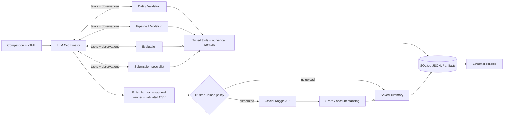

# ⚡ KaggleSlayer

### Autonomous Multi-Agent ML Competition Team

KaggleSlayer turns tabular competition CSVs into measured experiments, trained checkpoints and a validated submission file. Five specialized agents collaborate through typed state, use cross-validation to guide improvements, and record decisions in SQLite and JSONL. A Streamlit console exposes the actual activity and results.

The goal is competitive performance with minimal competition-specific code. **Top 20% is an aspiration, never a promised result.** The CLI defaults to the agentic configuration, using an LLM coordinator and specialist sessions to choose executable actions, observe measured results, and revise the pipeline. Configure the LLM provider/model/key before running. Offline deterministic operation remains available with `--execution-mode deterministic`. Upload permission belongs to trusted runtime policy.

## Recorded competition demo

The [Home Data personal-best audit package](demo/home-data-for-ml-course-8ed561cbed5e/README.md) preserves completed live agentic run **`8ed561cbed5e`** in a permanent `demo/` directory, with its original logs, trained checkpoints, experiment results, validated predictions and Kaggle receipts. Its LightGBM + CatBoost ensemble measured **15,257.82778 CV MAE** and **14,252.33305 Kaggle public MAE**, submission **57535510**, status **COMPLETE**. This new personal best lowers public MAE by **3.97%** relative to the previous featured demo (**14,840.83581**). The [previous audit package](demo/home-data-for-ml-course-2655b38be9fe/README.md) remains available unchanged.

After installing dependencies below, verify the evidence and display this run without retraining, LLM requests or another upload:

```bash
uv run --locked python demo/home-data-for-ml-course-8ed561cbed5e/audit.py verify
uv run --locked python demo/home-data-for-ml-course-8ed561cbed5e/audit.py dashboard --port 8502
```

Open [the recorded-run dashboard](http://localhost:8502), or read the [offline audit report](demo/home-data-for-ml-course-8ed561cbed5e/index.html). The one-run dashboard rebuilds its local SQLite index from the archived evidence and selects this run automatically. Original run files have SHA-256 checksums and remain unchanged. All six model experiments completed. The saved account standing is **304 / 3,876 teams (top 7.84%)**, scoped to `current_account_best`; account rank and this submission's public score remain separate records.

## LLM-directed agentic mode

```bash
# Configure the existing KS_LLM_PROVIDER, KS_LLM_MODEL and KS_LLM_API_KEY first.
uv run --locked python -m kaggle_slayer run --competition titanic
# Offline demonstration: fake LLM responses, real model training and validated predictions.
uv run --locked python -m examples.scripted_swarm --output artifacts/swarm-example
```

The coordinator delegates to data/validation, pipeline/modeling, evaluation, and submission specialists as needed. Agents select supported preprocessing, feature operations, model parameters, trials, ensembles and stopping through validated action/tool contracts. Independent LLM tasks and experiments can run concurrently; a single scheduler reserves resources and commits evidence. Provider failures checkpoint an explicit incomplete outcome. Old runs retain deterministic execution.

See [agentic usage and recovery](docs/agentic-usage.md), [versioned schemas/prompts](docs/contracts/swarm-v1), and [offline execution evidence](evidence/swarm-offline.md). The deterministic workflow below remains available as a separate mode; its optional initial model-ordering advice is a legacy feature.

## Features

- Official Kaggle metadata, authenticated downloads, explicitly authorized single-attempt uploads and submission feedback.
- Binary/multiclass tabular classification and single-target regression, with YAML overrides for ambiguous requirements.
- Six model families available to the agentic team: linear models, Random Forest, histogram gradient boosting, LightGBM, CatBoost and XGBoost.
- Fold-fit preprocessing, stratified/K-fold/group/time validation and inner-fold early stopping. Deterministic mode uses bounded Optuna optimization.
- CV-tested voting/averaging inside the experiment budget; agentic mode chooses whether to request ensembles and finalist confirmations.
- Metric-direction handling, overfitting warnings, OOF evidence, model checkpoints, feature importance and strict submission checks.
- Durable decisions, configuration/environment snapshots, data fingerprints, worker timeouts and interrupted-run recovery.
- Dashboard with history, agent/tool timeline, experiment comparisons, actual feedback and artifact downloads.
- Offline tests, synthetic demos, a real public Titanic holdout demo, Docker and uv-based CI.

## Architecture



| Agent | Specialization |
|---|---|
| Coordinator | Delegates tasks, consumes observations, revises the experiment plan and requests completion within the configured budgets. |
| Data / Validation | Inspects CSVs, resolves schema, audits quality/leakage and prepares validation splits. |
| Pipeline / Modeling | Selects supported preprocessing, features, model parameters and experiments; numerical workers persist metrics and checkpoints. |
| Evaluation | Requests measured rankings, error diagnostics and finalist confirmations, then reports evidence to the coordinator. |
| Submission | Generates and validates predictions for the measured winner. Upload authorization and execution belong to trusted runtime policy. |

This diagram and table describe the default agentic mode. Deterministic compatibility mode uses a Competition Planner, Data Engineer, Modeler, Evaluator and Leaderboard Reviewer with distinct tools and policies. See [architecture](docs/architecture.md), [agent contracts](docs/agents.md) and [technical decisions](docs/decisions.md).

Actual upload and Kaggle feedback retrieval occur after the agentic loop finishes. The current agentic flow records scores and account standing but does not start another LLM planning turn from that feedback. Deterministic mode can produce `next_run_plan.json` after submission or `refresh`; leaderboard-driven replanning is therefore only partially implemented across the two modes.

## Stack and installation

Python 3.11–3.13, Pydantic, pandas/NumPy, scikit-learn, LightGBM, CatBoost, XGBoost, Optuna, joblib, the official Kaggle API, httpx, SQLite, Streamlit and Plotly. **uv manages Python, environments, dependencies and execution throughout.**

Install [uv](https://docs.astral.sh/uv/getting-started/installation/), open this directory and run:

```bash
uv python install 3.11
uv python pin 3.11
uv sync --locked --extra dev
uv run --locked python -m kaggle_slayer doctor
```

CatBoost and XGBoost are included in the standard installation; no boosting extra is needed. Run `uv sync --locked --extra dev` after updating an existing checkout. The old `boosting` extra is retained as an empty compatibility alias.

Copy `.env.example` to `.env` using your editor. **The example sets `KS_LLM_PROVIDER=deterministic`, while the CLI defaults to agentic execution.** These are separate settings: choose `--execution-mode deterministic` for the offline workflow, or configure a compatible LLM provider/model and any required key before an agentic run. Setting the provider alone does not select the execution mode.

Secrets, datasets, virtual environments and generated runs are ignored by Git. `uv.lock` records core and development dependencies. Use `uv run --locked` to preserve that dependency resolution. See [reproducibility](docs/reproducibility.md) for restricted Windows environments and lockfile policy.

## Live execution logging

CLI runs show the active agent, experiment/model, budget position, validation role, fold activity, measured fold scores, refit, model selection and confirmation status. During worker startup or long training, a heartbeat appears every ten seconds with elapsed experiment time and the latest stage. No extra verbosity flag is needed.

Each line has a UTC timestamp and is saved under `artifacts/runs/<run-id>/progress.log`. Structured worker events are saved in each experiment's `progress.jsonl`, while detailed library output stays in `worker.log`. Agent decisions remain in SQLite and `decisions.jsonl`. Raw LLM responses, credentials and raw worker stdout are not streamed to the console. `resume` and `submit` use the same live reporting; `refresh` reports reviewer activity.

## Deterministic mode and legacy initial advice

`KS_LLM_PROVIDER=deterministic` disables LLM requests. Pair it with `--execution-mode deterministic` for local CSV workflows without a provider key or network access. The deterministic agents still perform specialized work, including feedback-driven tuning.

```bash
# With KS_LLM_PROVIDER=deterministic in .env and existing local CSVs:
uv run --locked python -m kaggle_slayer run --competition titanic --data-dir data/titanic --execution-mode deterministic --no-submit
```

To configure an endpoint in `.env`:

```dotenv
KS_LLM_PROVIDER=openrouter
KS_LLM_API_KEY=your-own-key
KS_LLM_MODEL=your-selected-model-id
```

Providers: `openrouter`, `groq`, `openai-compatible`, `local`, or `deterministic`. For a local compatible server, use `KS_LLM_PROVIDER=local`, `KS_LLM_BASE_URL=http://localhost:11434/v1` and a model installed on that server. No local model download is automatic. In deterministic mode, invalid/unavailable initial advice falls back to deterministic planning with a warning. Agentic mode never falls back. The legacy initial request sends bounded schema/quality and target aggregates, validation settings, budgets and model capabilities. Column names and target statistics may still be sensitive in that legacy request; agentic context uses opaque feature IDs. Raw rows, category values, class label names, credentials and local paths are excluded. Suggestions cannot change metrics, budgets or submission authorization.

The versioned [initial planner prompt](src/kaggle_slayer/llm/prompts.py) belongs to deterministic mode's optional legacy advice. It requests a brief rationale, allowed-model priorities and up to two dataset risks before training; Python retains the experiment policy. The agentic team instead uses the [role-specific action contracts](docs/contracts/swarm-v1) throughout execution.

To test one provider request using the legacy planning schema, without downloading data or training models:

```bash
uv run --locked python -m kaggle_slayer llm-check
```

This sends **one** request with synthetic context using the configured provider/model and output budget. It checks provider connectivity and legacy advice parsing; it does not demonstrate the full agentic action protocol or workflow. `KS_LLM_MAX_TOKENS` accepts 128–32768: the code default is 700, while the supplied `.env.example` overrides it to 32768. Choose a value supported by your endpoint and within the run's aggregate budget. This is a per-request output limit, not a monetary budget. The check may consume provider credits or free-tier quota. It never retries, changes models, or contacts Kaggle. A failed check exits with code 1; a deterministic provider reports `disabled` and makes no request. The ordinary `doctor` command does not test LLM requests.

Failures now identify configuration problems, HTTP authentication/credit/rate-limit errors, unsupported JSON mode, timeouts, invalid JSON, truncated output or planning-schema mismatches. Safe diagnostics include provider/model, HTTP status, a category and corrective action. Model runs save these under `metadata.llm_diagnostic` and in an agent decision, visible in the dashboard. Credentials, response bodies, headers, exception text and failed model-output values are excluded. See [LLM troubleshooting](docs/llm-troubleshooting.md).

## Kaggle authentication and rules

Use [Kaggle account settings](https://www.kaggle.com/settings) to configure credentials. Supported official configuration includes `KAGGLE_API_TOKEN`, `KAGGLE_USERNAME` plus `KAGGLE_KEY`, or `~/.kaggle/kaggle.json` (`%USERPROFILE%\.kaggle\kaggle.json` on Windows). `KAGGLE_CONFIG_DIR` can point to a separate credential directory. Never commit credentials.

Open the competition website and manually accept its rules if required. Some competitions restrict eligibility or require notebook execution; this runner does not bypass those restrictions. The server enforces account quotas. KaggleSlayer permits at most one attempted upload per run and never retries an uncertain upload.

```bash
uv run --locked python -m kaggle_slayer doctor --competition titanic --require-kaggle
```

The authenticated check must succeed before an official run can download data. Local CSV execution remains available with `--data-dir`.

## Run a competition

```bash
# Agentic default: configure the LLM first; agents choose work within the budget.
uv run --locked python -m kaggle_slayer run --competition titanic

# Explicitly authorize one upload after training and validation.
uv run --locked python -m kaggle_slayer run --competition titanic --submit

# Deterministic search: five baselines, tuning, an ensemble and finalist checks.
uv run --locked python -m kaggle_slayer run --competition titanic --execution-mode deterministic --no-submit

# Explicit row-limit override for a supported tabular competition.
uv run --locked python -m kaggle_slayer run --competition playground-series-s6e10 --max-rows 4000000 --no-submit

# Use official files already downloaded locally.
uv run --locked python -m kaggle_slayer run --competition titanic --data-dir data/titanic --no-submit

# Switch task and metric using the included profile.
uv run --locked python -m kaggle_slayer run --competition house-prices-advanced-regression-techniques --no-submit

# Optional deterministic profile with three model families and an ensemble.
uv run --locked python -m kaggle_slayer run --competition titanic --config configs/ensemble.yaml --execution-mode deterministic --no-submit
```

`--max-dense-cells` overrides the default 40-million encoded-cell memory guard. This estimates preprocessing size rather than enforcing an OS memory limit. Dataset row, memory and unresolved-metric failures stop agentic runs with a specific error and corrective option, instead of spending more LLM requests on unchanged constraints. Set a new limit or profile when starting a new run; saved constraints remain immutable.

Source-data size is checked during inspection; candidate-specific encoding, missing indicators and derived features are checked before reserving an experiment and again in the worker. CatBoost uses native feature counts, while ensembles check each member's preprocessing. A candidate rejected before training does not consume an agentic experiment slot and returns the reason and size counts for correction.

Use `uv run --locked python -m kaggle_slayer run --help` for flags. `--profile path.yaml` supplies competition schema/metric overrides; `--config path.yaml` supplies run budgets and model choices. CLI values take precedence. `--max-rows` overrides the default one-million-row CSV limit; file-size and memory limits still apply.

| Setting | Agentic CLI default | Deterministic default |
|---|---|---|
| Run profile | `configs/agentic.yaml` | `configs/default.yaml` |
| Experiment budget | 8 | 12 |
| Per-experiment timeout | 180 seconds | 300 seconds |
| Validation / CPU / total time | 5 folds / 2 threads / 30 minutes | 5 folds / 2 threads / 30 minutes |
| Model roster | Six allowed families, including histogram gradient boosting | Five baseline families, excluding histogram gradient boosting |
| Experiment scheduling | LLM-selected actions; tuning, ensembles and confirmations are optional capabilities | Normally five baselines, four tuning trials, one ensemble and two finalist confirmations |

The agentic profile additionally caps requests/turns at 80, aggregate charged tokens at 1,000,000 and concurrent agent calls at two. There is no mandatory baseline sequence or reserved optional-work queue in this mode. An eight-experiment budget is a ceiling, not a requirement to train eight models. Edit `models` in the selected run profile or pass an explicit `--config`; the agentic profile overrides the roster in `configs/default.yaml`.

When passing a custom `--config`, set `execution_mode: agentic` in that file or pass `--execution-mode agentic` to retain agentic execution. An explicit profile without an execution mode uses the schema's deterministic default.

In deterministic mode, the planner explores leading families before concentrating remaining trials on the winner. `--max-experiments 5` funds its five baselines. Failed training attempts consume budget; time limits may stop either mode early. Saved runs retain their recorded configuration.

Default preprocessing gives CatBoost native categorical features; other trees use unscaled, fold-imputed features with numeric missingness indicators, while linear models use scaling. Agentic pipelines can choose supported imputation, scaling and feature operations through their tool contracts. Regression losses follow MAE or squared error where supported; each experiment records its actual training contract and any surrogate/transformed-target mismatch. Ensembles keep independent preprocessing per member and must beat the best single model by more than the configured relative improvement threshold (default 0.1%).

Finalist confirmations freeze hyperparameters and use a second split seed. They are diagnostics, excluded from primary ranking, and do not change selection or trigger more tuning. They reuse labels and **are not an untouched holdout**. Group/time validation is preserved and skips random-seed confirmation. The dashboard exposes stability and aggregate out-of-fold error slices; LLM planning cautions appear in decision history and metadata rather than execution warnings. See [experiment protocol](docs/experiments.md).

An executed cached-data Home Data benchmark improved local MAE from **16,334.15 to 15,539.69** on identical primary folds and data fingerprints. The selected ensemble also beat the single-model finalist on a second split seed. It was **not submitted**, and the train/CV gap remains flagged. See [measured evidence and reproduction](evidence/search-improvements.md); local gains do not guarantee public-score gains.

To reproduce that deterministic benchmark with cached official data, select both settings explicitly. The older command in the evidence document predates the CLI's agentic default:

```powershell
$env:KS_LLM_PROVIDER = 'deterministic'
uv run --locked python -m kaggle_slayer run --competition home-data-for-ml-course --data-dir data/home-data-for-ml-course --execution-mode deterministic --no-submit
```

Another competition can use a profile such as:

```yaml
competition: my-competition
target: outcome
id_column: record_id
task: classification
metric: roc_auc
prediction_kind: probability
train_file: train.csv
test_file: test.csv
sample_file: sample_submission.csv
validation: stratified
```

The runner infers a single train-only target and template identifier when unambiguous. Task inference uses type/cardinality; explicitly override integer-valued regression. Metrics require a known profile, recognized API metadata or YAML. Unresolved relationships/formats produce errors. See [experiment details](docs/experiments.md) for metrics, positive-class conventions and validation choices.

## Inspect, resume and submit a saved result

Replace `RUN_ID` with the ID from an actual run:

```bash
uv run --locked python -m kaggle_slayer runs
uv run --locked python -m kaggle_slayer inspect RUN_ID
uv run --locked python -m kaggle_slayer resume RUN_ID
uv run --locked python -m kaggle_slayer submit RUN_ID
uv run --locked python -m kaggle_slayer refresh RUN_ID
```

`submit RUN_ID` explicitly authorizes one upload of a completed run's validated CSV. It verifies file integrity and refuses fixture/public-demo data or a second attempt. Resume verifies dataset fingerprints and reuses completed experiments; submission permission must be supplied again with `resume --submit`. A completed resume is a no-op; use `submit` to upload a completed no-submit run. `refresh` only reads feedback.

## Dashboard

```bash
uv run --locked streamlit run dashboard/app.py
```

Open [localhost:8501](http://localhost:8501). Overview, Agent Activity, Experiments, Competition Performance and Artifacts read the actual SQLite store. Select a run, inspect decisions, compare models, view EDA and download predictions. Enable automatic refresh during training. `KS_ARTIFACT_ROOT` or the sidebar selects another artifact directory. This is a trusted local console, without hosted authentication.

## Demonstrations and measured results

These scripts select deterministic execution directly. Keep `KS_LLM_PROVIDER=deterministic` in `.env` to disable their optional legacy LLM advice request; a configured remote provider can otherwise make a request even in deterministic execution.

```bash
# Offline synthetic examples with KS_LLM_PROVIDER=deterministic.
uv run --locked python scripts/demo.py
uv run --locked python scripts/demo.py --task regression

# Real public observations; public internet, no Kaggle credentials.
uv run --locked python scripts/public_titanic_demo.py
```

The public demo downloads from the [seaborn example data repository](https://github.com/mwaskom/seaborn-data), creates a local stratified 80/20 holdout and evaluates it once after selection. It records the downloaded source hash but currently uses a mutable `master` URL rather than a pinned revision or expected hash. Future downloads may therefore differ from the historical evidence. **This is not an official Kaggle download, test set, submission or leaderboard result.** Demo data is marked in `provenance.json` and prohibited from upload.

The real public Titanic run measured **0.82305 five-fold CV accuracy and 0.78212 untouched local holdout accuracy**, with 712 training and 179 holdout rows. The difference is reported honestly; holdout labels were never fed back into planning. Synthetic classification measured 0.78333 CV accuracy, and synthetic regression measured 0.14961 RMSLE. See the [actual execution evidence](evidence/README.md) for per-experiment results, logs and provenance. None of these numbers establishes a competition rank.

The committed [execution evidence](evidence/README.md) is a historical snapshot. It includes the original deterministic Titanic submission **57504220** with public accuracy **0.75358**, an unsubmitted House Prices run and synthetic/public-data demonstrations. The committed [swarm demonstration](evidence/swarm-offline.md) uses scripted fake LLM responses with real training; it does not itself prove live provider or Kaggle execution.

**Later official runs completed with real Kaggle submissions.** The following results were verified against saved local run state and API responses on **October 22, 2026 (America/Sao_Paulo)**. All listed submissions have recorded status `COMPLETE`; the four agentic runs also contain successful live-provider telemetry.

| Competition | Execution / selected model | Five-fold local CV | Kaggle public score | Submission reference |
|---|---|---:|---:|---|
| Home Data for ML Course | Deterministic with initial LLM advice / LightGBM + XGBoost ensemble | 15,539.69267 MAE | 14,672.93702 | `57507548` |
| Titanic | Agentic / Random Forest + LightGBM ensemble | 0.84061 accuracy | 0.75837 | `57532150` |
| House Prices | Agentic / LightGBM | 0.13485 log RMSE | 0.12989 | `57533216` |
| Playground S6E10 | Agentic / LightGBM | 0.95782 ROC AUC | 0.95712 | `57533948` |
| Playground S5E3 | Agentic / logistic regression | 0.89480 ROC AUC | 0.86001 | `57534050` |

The corresponding run IDs are:

- `home-data-for-ml-course-ed7b068bb2b0`
- `titanic-921d899100fc`
- `house-prices-advanced-regression-techniques-6f332cf0f5ae`
- `playground-series-s6e10-8b8914201f44`
- `playground-series-s5e3-905de5a43690`

On the original workstation, use `uv run --locked python -m kaggle_slayer inspect RUN_ID` to inspect these records. Their detailed state, decisions, provider usage, checkpoints and upload receipts remain under ignored `artifacts/runs/<run-id>/` directories. **Those newer live-run artifacts are not included in a fresh clone or the committed evidence package.** Generating a new run creates new local evidence; it does not restore these historical runs.

The separately archived personal-best run `home-data-for-ml-course-8ed561cbed5e` is the primary audit demo. Its [permanent package](demo/home-data-for-ml-course-8ed561cbed5e/README.md) includes live agentic traces and checkpoints, with public MAE **14,252.33305**. The [previous featured run](demo/home-data-for-ml-course-2655b38be9fe/README.md) is preserved separately; the older runs in the table above remain local historical records.

Home Data's saved account standing was **353 of 3,862 teams (top 9.14%)**. Its scope is explicitly `current_account_best`, so it may reflect a different submission and is not conclusive proof that this run achieved top 20%. The same distinction applies to every displayed account rank. The Titanic run above also retains a substantial CV/public gap of about **0.08224**; local scores and workflow completion do not establish competitive generalization.

## Tests and code quality

```bash
uv run --locked pytest
uv run --locked ruff check src tests dashboard scripts examples
uv run --locked ruff format --check src tests dashboard scripts examples
```

Tests cover configuration, state/recovery, fold-fit transforms, split integrity, metrics/direction, submission formats, mocked Kaggle operations, upload safety, provider fallback, all default model families and Streamlit rendering. Default tests never need live Kaggle credentials. CatBoost and XGBoost training tests are required and do not skip. [Test evidence](evidence/README.md) reports historical results; supplied GitHub Actions have not been executed remotely in this build.

## Artifacts and example output

Each run writes `artifacts/runs/<run-id>/`: state, decisions, summary, evaluation, comparison/EDA HTML, split indices, checkpoints, OOF arrays, importance CSVs and `submissions/submission.csv`. `artifacts/metadata.sqlite` serves the dashboard and history. Every decision includes agent, timestamp, context, action, rationale, tool/result, artifacts and next action. Snapshots include seeds, package versions and dataset hashes.

A run prints its actual ID, execution status, measured metric, selected checkpoint and CSV path. Runs without an upload report `leaderboard.status=not_submitted`; submitted runs record actual feedback when available. Curated [example submissions and logs](evidence/) are exported from executed demos. Raw competition datasets remain excluded. The primary audit demo includes a narrowly scoped Git exception for its six trained checkpoints; per-row OOF labels and the target-value chart remain local-only.

Ordinary run checkpoints are generated as `artifacts/runs/<run-id>/experiments/<experiment-id>/model.joblib`. The primary audit demo preserves them under `demo/home-data-for-ml-course-8ed561cbed5e/runs/home-data-for-ml-course-8ed561cbed5e/experiments/`, including the selected `ens_lgbm_cat/model.joblib`. Its manifest records **77 original file hashes**; `audit.py verify` checks the **70 shareable files**, and `verify --full` additionally checks the **seven local-only label outputs**. The earlier source archive under ignored `dist/` predates these audit packages.

The README, source/configuration, technical documentation, demonstration commands, logs, plots, dashboard screenshots and two live agentic audit packages with checkpoints are present. Remaining work includes establishing a submission-specific competitive standing and implementing agentic replanning after Kaggle feedback.

## Development and Docker

```bash
uv add pandas
uv add --optional dev pytest
uv sync --locked --extra dev
uv lock --upgrade
```

The Dockerfile uses uv and the OpenMP runtime needed by LightGBM. Build with `docker build -t kaggle-slayer .` and run with `docker run --rm -p 8501:8501 -v ./artifacts:/app/artifacts kaggle-slayer`. Mount credentials separately for authorized competition runs. Docker execution has not been verified in this environment.

## Limitations and next steps

Scope is CPU-based, in-memory tabular CSV classification/regression with one target. Image/NLP models, arbitrary joins, multi-output problems, notebook-only submissions, distributed training and automatic rule acceptance are unsupported. Dense encoding limits may restrict large data. Leakage warnings do not prove absence of subtle leakage; grouped/time validation remains a competition-specific choice. Repeated CV selection can overfit validation. LLM endpoints and authenticated Kaggle operations require configuration. Performance and leaderboard percentile are never guaranteed.

Reproduction preserves recorded seeds, data fingerprints, split indices and dependency versions, but does not promise identical live LLM choices or byte-for-byte replay. An interrupted Optuna sampler's RNG stream is not fully checkpointed, and platform/library differences can change numerical results. The public-data demo uses a mutable source; historical checkpoints outside the archived audit demo remain local-only.

Future improvements: agentic planning after leaderboard feedback, nested evaluation of selection policies, pinned public-demo inputs, richer profile discovery, stronger shift/leakage diagnostics, exact sampler-RNG replay and hosted dashboard authentication. Continue with the [demo walkthrough](docs/demo.md), [experiment protocol](docs/experiments.md) and [reproducibility guide](docs/reproducibility.md). When using older walkthroughs or evidence commands, select `--execution-mode deterministic` explicitly for historical deterministic workflows; the CLI now defaults to agentic mode.
