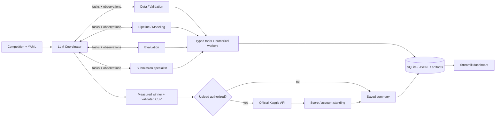

# ⚡ KaggleSlayer

### Autonomous Multi-Agent ML Competition Team

KaggleSlayer uses an LLM coordinator and four specialist agents to turn tabular competition data into measured experiments, trained checkpoints and a validated Kaggle submission. Agents choose and revise experiments using cross-validation results; decisions and tool activity are saved for inspection in a Streamlit dashboard.

Start with the [recorded demo](#recorded-competition-demo) to inspect a completed run, [set up the project](#setup) to run your own competition, or read [CONTRIBUTING.md](CONTRIBUTING.md) to develop and test.

## Recorded competition demo

The [Home Data audit package](demo/home-data-for-ml-course-8ed561cbed5e/README.md) preserves live agentic run **`8ed561cbed5e`**, including all six trained checkpoints, decisions, predictions and official Kaggle receipts.

| Competition | Selected model | Five-fold CV MAE | Kaggle public MAE | Submission |
|---|---|---:|---:|---|
| Home Data for ML Course | LightGBM + CatBoost ensemble | 15,257.82778 | **14,252.33305** | **57535510 · COMPLETE** |

The saved account standing is **304 / 3,876 teams (top 7.84%)**, scoped to `current_account_best`. This account-level standing is separate from the submission-specific score. The ensemble improved CV MAE by 1.88% over the strongest single model; the recorded train/CV gap warning remains available for review.

After [installing dependencies](#setup), verify and display the saved run:

```bash
uv run python demo/home-data-for-ml-course-8ed561cbed5e/audit.py verify
uv run python demo/home-data-for-ml-course-8ed561cbed5e/audit.py dashboard --port 8502
```

Open [the recorded-run dashboard](http://localhost:8502). Viewing this run needs no LLM or Kaggle credentials and does not retrain or upload. The [demo walkthrough](docs/demo.md) shows the expected verification output and evidence to inspect. To view the HTML report, follow the [standalone report instructions](docs/demo.md#standalone-report).

## Architecture



The coordinator delegates inspection and validation, pipeline/modeling, evaluation, and submission preparation. Independent calls and experiments can run concurrently; one scheduler owns state and budgets. Python tools compute metrics and enforce validation and upload permission. See [agent roles](docs/agents.md) and [execution contracts](docs/architecture.md).

The team supports classification and single-target regression with linear models, Random Forest, histogram gradient boosting, LightGBM, CatBoost and XGBoost. Agents choose whether to tune, ensemble, confirm or stop within the budget. Provider failure saves an incomplete outcome for inspection or recovery.

## Setup

Install [uv](https://docs.astral.sh/uv/getting-started/installation/), then run from the repository root:

```bash
uv python install 3.11
uv sync --extra dev
```

Python 3.11–3.13 is supported; the repository pins 3.11. CatBoost and XGBoost are included in the standard installation. `uv run` synchronizes the environment and may update `uv.lock` if project metadata has changed. See [reproducibility](docs/reproducibility.md) for environment details.

### LLM configuration

For a new live run, copy `.env.example` to `.env` and replace the provider placeholders:

```dotenv
KS_LLM_PROVIDER=openrouter
KS_LLM_API_KEY=your-openrouter-api-key
KS_LLM_MODEL=your-selected-model-id
```

Supported providers are `openrouter`, `groq`, `openai-compatible` and `local`. A local compatible server also needs `KS_LLM_BASE_URL` and an installed model. Select an output allowance supported by your endpoint; the template sets `KS_LLM_MAX_TOKENS=32768`. See [agentic configuration](docs/agentic-usage.md) and [provider troubleshooting](docs/llm-troubleshooting.md).

### Kaggle authentication and rules

Configure Kaggle credentials using `KAGGLE_API_TOKEN`, `KAGGLE_USERNAME` plus `KAGGLE_KEY` in `.env`, or `~/.kaggle/kaggle.json` (`%USERPROFILE%\.kaggle\kaggle.json` on Windows). `KAGGLE_CONFIG_DIR` can select another credential directory. Get credentials from [Kaggle settings](https://www.kaggle.com/settings), and accept the competition rules on its website. Credentials and downloaded datasets remain private local files.

Check access using your competition slug:

```bash
uv run kaggle-slayer doctor --competition competition-name --require-kaggle
```

The recorded demo and [scripted offline checks](docs/demo.md#offline-integration-checks) need neither provider nor Kaggle credentials.

## Run a competition

Replace `competition-name` with the slug from its Kaggle URL.

```bash
# Train and validate without submitting.
uv run kaggle-slayer run --competition competition-name --no-submit

# Train, validate, and submit to Kaggle.
uv run kaggle-slayer run --competition competition-name --submit
```

The CLI uses `configs/agentic.yaml` by default, allowing up to eight experiments within a 30-minute run budget. Agents can stop earlier. Uploads require explicit authorization and allow one attempted upload per run; uncertain uploads are never retried automatically.

For another dataset, follow [Configure another competition](docs/experiments.md#configure-another-competition). `--profile` supplies competition schema and metric settings; `--config` supplies execution mode, budgets and allowed models. A custom config must declare `execution_mode: agentic` or use `--execution-mode agentic` to retain agentic execution. See [configuration and recovery](docs/agentic-usage.md) for defaults and limits.

## Saved runs and dashboard

Replace `RUN_ID` with the ID printed by an actual run:

```bash
uv run kaggle-slayer runs
uv run kaggle-slayer inspect RUN_ID
uv run kaggle-slayer resume RUN_ID
uv run kaggle-slayer submit RUN_ID
uv run kaggle-slayer refresh RUN_ID
```

`submit` authorizes one upload of a completed run's validated predictions. `refresh` reads official feedback. Resume reuses completed work and retains saved limits; see [when to resume or start a new run](docs/agentic-usage.md#resume-or-start-a-new-run).

To inspect your own runs:

```bash
uv run streamlit run dashboard/app.py
```

Open [localhost:8501](http://localhost:8501), select a run, and inspect agent activity, experiments, comparisons and artifacts. Use the separate recorded-demo command above to view the archived run.

Runs save under `artifacts/runs/<run-id>/`. The CLI reports live progress; `progress.log`, `decisions.jsonl` and SQLite retain the activity and decision summaries. Checkpoints, validation reports and the submission CSV are saved with the run. See [logging and artifacts](docs/architecture.md#logging-and-artifacts) and the [evidence index](evidence/README.md).

## Tests

```bash
uv run pytest
uv run ruff check src tests dashboard scripts examples
uv run ruff format --check src tests dashboard scripts examples
```

Tests use mocked providers, Kaggle operations and local fixtures. [Historical verification reports](evidence/README.md#engineering-verification) describe their recorded executions. See [CONTRIBUTING.md](CONTRIBUTING.md) for development and dependency maintenance.

## Limitations

This runner targets CPU-based, in-memory tabular CSV competitions with one target. Image/NLP models, arbitrary joins, multi-output tasks, notebook-only submissions and distributed training are unsupported. Schema or metric ambiguity requires a competition profile. Validation choices affect results, and repeated CV selection can overfit; top-20% performance is a goal, never a guarantee.

Recorded seeds, fingerprints, splits and dependencies support auditing, but live LLM choices and numerical results can vary. Kaggle feedback is recorded after the agentic loop ends; automatically planning a new run from that feedback remains future work.

## Documentation

| Guide | Purpose |
|---|---|
| [Demo walkthrough](docs/demo.md) | Verify the saved result, inspect evidence, or run offline integration checks |
| [Agentic usage](docs/agentic-usage.md) | Provider setup, budgets, cancellation and recovery |
| [Experiment protocol](docs/experiments.md) | Competition profiles, preprocessing, CV, tuning and selection |
| [Architecture](docs/architecture.md) and [agents](docs/agents.md) | Components, role permissions, persistence and execution contracts |
| [Reproducibility](docs/reproducibility.md) | Environment setup, data fingerprints and platform considerations |
| [Troubleshooting](docs/llm-troubleshooting.md) | Provider errors and agentic diagnostics |
| [Offline baselines](docs/offline-baselines.md) | Explicit deterministic compatibility workflows |
| [Technical decisions](docs/decisions.md) | Design choices and tradeoffs |
