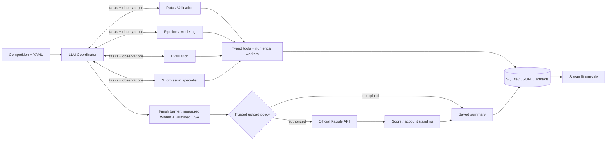

# ⚡ KaggleSlayer

### Autonomous Multi-Agent ML Competition Team

KaggleSlayer turns tabular competition CSVs into measured experiments, trained checkpoints and a validated submission file. Five specialized agents collaborate through typed state, use cross-validation to guide improvements, and record decisions in SQLite and JSONL. A Streamlit console exposes the actual activity and results.

The goal is competitive performance with minimal competition-specific code. **Top 20% is an aspiration, never a promised result.** The CLI defaults to the agentic configuration, using an LLM coordinator and specialist sessions to choose executable actions, observe measured results, and revise the pipeline. Configure the LLM provider/model/key before running. Upload permission belongs to trusted runtime policy.

## Recorded competition demo

The [Home Data personal-best audit package](demo/home-data-for-ml-course-8ed561cbed5e/README.md) preserves completed live agentic run **`8ed561cbed5e`** in a permanent `demo/` directory, with its original logs, trained checkpoints, experiment results, validated predictions and Kaggle receipts. Its LightGBM + CatBoost ensemble measured **15,257.82778 CV MAE** and **14,252.33305 Kaggle public MAE**, submission **57535510**, status **COMPLETE**.

After installing dependencies below, verify the evidence and display this run without retraining, LLM requests or another upload:

```bash
uv run --locked python demo/home-data-for-ml-course-8ed561cbed5e/audit.py verify
uv run --locked python demo/home-data-for-ml-course-8ed561cbed5e/audit.py dashboard --port 8502
```

Open [the recorded-run dashboard](http://localhost:8502), or read the [offline audit report](demo/home-data-for-ml-course-8ed561cbed5e/index.html). The one-run dashboard rebuilds its local SQLite index from the archived evidence and selects this run automatically. Original run files have SHA-256 checksums and remain unchanged. All six model experiments completed. The saved account standing is **304 / 3,876 teams (top 7.84%)**, scoped to `current_account_best`; account rank and this submission's public score remain separate records.

## LLM-directed agentic mode

```bash
# Configure the existing KS_LLM_PROVIDER, KS_LLM_MODEL and KS_LLM_API_KEY first.
uv run --locked python -m kaggle_slayer run --competition titanic
# Offline demonstration: fake LLM responses, real model training and validated predictions.
uv run --locked python -m examples.scripted_swarm --output artifacts/swarm-example
```

The coordinator delegates to data/validation, pipeline/modeling, evaluation, and submission specialists as needed. Agents select supported preprocessing, feature operations, model parameters, trials, ensembles and stopping through validated action/tool contracts. Independent LLM tasks and experiments can run concurrently; a single scheduler reserves resources and commits evidence. Provider failures checkpoint an explicit incomplete outcome.

See [agentic usage and recovery](docs/agentic-usage.md), [versioned schemas/prompts](docs/contracts/swarm-v1), and [offline execution evidence](evidence/swarm-offline.md).

## Features

- Official Kaggle metadata, authenticated downloads, explicitly authorized single-attempt uploads and submission feedback.
- Binary/multiclass tabular classification and single-target regression, with YAML overrides for ambiguous requirements.
- Six model families available to the agentic team: linear models, Random Forest, histogram gradient boosting, LightGBM, CatBoost and XGBoost.
- Fold-fit preprocessing, stratified/K-fold/group/time validation and inner-fold early stopping.
- CV-tested voting/averaging inside the experiment budget; agentic mode chooses whether to request ensembles and finalist confirmations.
- Metric-direction handling, overfitting warnings, OOF evidence, model checkpoints, feature importance and strict submission checks.
- Durable decisions, configuration/environment snapshots, data fingerprints, worker timeouts and interrupted-run recovery.
- Dashboard with history, agent/tool timeline, experiment comparisons, actual feedback and artifact downloads.
- Offline tests, synthetic demos, a real public Titanic holdout demo and uv-based CI.

## Architecture



| Agent | Specialization |
|---|---|
| Coordinator | Delegates tasks, consumes observations, revises the experiment plan and requests completion within the configured budgets. |
| Data / Validation | Inspects CSVs, resolves schema, audits quality/leakage and prepares validation splits. |
| Pipeline / Modeling | Selects supported preprocessing, features, model parameters and experiments; numerical workers persist metrics and checkpoints. |
| Evaluation | Requests measured rankings, error diagnostics and finalist confirmations, then reports evidence to the coordinator. |
| Submission | Generates and validates predictions for the measured winner. Upload authorization and execution belong to trusted runtime policy. |

This diagram and table describe the agentic workflow. See [architecture](docs/architecture.md), [agent contracts](docs/agents.md) and [technical decisions](docs/decisions.md).

Actual upload and Kaggle feedback retrieval occur after the agentic loop finishes. Scores and account standing are recorded; planning a new run from that feedback remains future work.

## Stack and installation

Python 3.11–3.13, Pydantic, pandas/NumPy, scikit-learn, LightGBM, CatBoost, XGBoost, Optuna, joblib, the official Kaggle API, httpx, SQLite, Streamlit and Plotly. **uv manages Python, environments, dependencies and execution throughout.**

Install [uv](https://docs.astral.sh/uv/getting-started/installation/), open this directory and run:

```bash
uv python install 3.11
uv python pin 3.11
uv sync --locked --extra dev
uv run --locked python -m kaggle_slayer doctor
```

CatBoost and XGBoost are included in the standard installation; no boosting extra is needed. Run `uv sync --locked --extra dev` after updating an existing checkout. The old `boosting` extra is retained as an empty compatibility alias.

Copy `.env.example` to `.env` using your editor. The template selects OpenRouter. Replace the model and API-key placeholders with your own configuration before starting a live agentic run. Existing working `.env` files can be kept as they are.

Secrets, datasets, virtual environments and generated runs are ignored by Git. `uv.lock` records core and development dependencies. Use `uv run --locked` to preserve that dependency resolution. See [reproducibility](docs/reproducibility.md) for restricted Windows environments and lockfile policy.

## Live execution logging

CLI runs show the active agent, experiment/model, budget position, validation role, fold activity, measured fold scores, refit, model selection and confirmation status. During worker startup or long training, a heartbeat appears every ten seconds with elapsed experiment time and the latest stage. No extra verbosity flag is needed.

Each line has a UTC timestamp and is saved under `artifacts/runs/<run-id>/progress.log`. Structured worker events are saved in each experiment's `progress.jsonl`, while detailed library output stays in `worker.log`. Agent decisions remain in SQLite and `decisions.jsonl`. Raw LLM responses, credentials and raw worker stdout are not streamed to the console. `resume` and `submit` use the same live reporting; `refresh` reports reviewer activity.

## LLM configuration

Configure your provider in `.env`:

```dotenv
KS_LLM_PROVIDER=openrouter
KS_LLM_API_KEY=your-openrouter-api-key
KS_LLM_MODEL=your-selected-model-id
```

Supported live providers are `openrouter`, `groq`, `openai-compatible` and `local`. A local compatible server also needs `KS_LLM_BASE_URL` and an installed model. Agents use the configured provider throughout execution; provider failure checkpoints an incomplete run.

The template sets `KS_LLM_MAX_TOKENS=32768`. Select an output allowance supported by your endpoint and within the aggregate run budget. Agent contexts contain aggregate evidence and opaque references; credentials, local paths and raw CSV rows are excluded. See [agentic configuration and recovery](docs/agentic-usage.md) and [provider diagnostics](docs/llm-troubleshooting.md).

## Kaggle authentication and rules

Use [Kaggle account settings](https://www.kaggle.com/settings) to configure credentials. Supported official configuration includes `KAGGLE_API_TOKEN`, `KAGGLE_USERNAME` plus `KAGGLE_KEY`, or `~/.kaggle/kaggle.json` (`%USERPROFILE%\.kaggle\kaggle.json` on Windows). `KAGGLE_CONFIG_DIR` can point to a separate credential directory. Never commit credentials.

Open the competition website and manually accept its rules if required. Some competitions restrict eligibility or require notebook execution; this runner does not bypass those restrictions. The server enforces account quotas. KaggleSlayer permits at most one attempted upload per run and never retries an uncertain upload.

```bash
uv run --locked python -m kaggle_slayer doctor --competition titanic --require-kaggle
```

The authenticated check must succeed before an official run can download data. Local CSV execution remains available with `--data-dir`.

## Run a competition

```bash
# Agentic default: configure the LLM first; agents choose work within the budget.
uv run --locked python -m kaggle_slayer run --competition titanic

# Explicitly authorize one upload after training and validation.
uv run --locked python -m kaggle_slayer run --competition titanic --submit

# Explicit row-limit override for a supported tabular competition.
uv run --locked python -m kaggle_slayer run --competition playground-series-s6e10 --max-rows 4000000 --no-submit

# Use official files already downloaded locally.
uv run --locked python -m kaggle_slayer run --competition titanic --data-dir data/titanic --no-submit

# Switch task and metric using the included profile.
uv run --locked python -m kaggle_slayer run --competition house-prices-advanced-regression-techniques --no-submit

```

`--max-dense-cells` overrides the default 40-million encoded-cell memory guard. This estimates preprocessing size rather than enforcing an OS memory limit. Dataset row, memory and unresolved-metric failures stop agentic runs with a specific error and corrective option, instead of spending more LLM requests on unchanged constraints. Set a new limit or profile when starting a new run; saved constraints remain immutable.

Source-data size is checked during inspection; candidate-specific encoding, missing indicators and derived features are checked before reserving an experiment and again in the worker. CatBoost uses native feature counts, while ensembles check each member's preprocessing. A candidate rejected before training does not consume an agentic experiment slot and returns the reason and size counts for correction.

Use `uv run --locked python -m kaggle_slayer run --help` for flags. `--profile path.yaml` supplies competition schema/metric overrides; `--config path.yaml` supplies run budgets and model choices. CLI values take precedence. `--max-rows` overrides the default one-million-row CSV limit; file-size and memory limits still apply.

| Setting | Agentic default |
|---|---|
| Run profile | `configs/agentic.yaml` |
| Experiment budget | 8 |
| Per-experiment timeout | 180 seconds |
| Validation / CPU / total time | 5 folds / 2 threads / 30 minutes |
| Model roster | Six allowed families, including histogram gradient boosting |
| Scheduling | LLM-selected actions; tuning, ensembles and confirmations are optional |
| LLM requests / turns | 80 each |
| Aggregate charged tokens | 1,000,000 |
| Concurrent agent calls | 2 |

The experiment budget is a ceiling. Agents choose which supported families to train and whether to request tuning, ensembling or finalist confirmation. Failed training attempts consume budget; time limits may stop a run early. Saved runs retain their recorded configuration.

For a custom `--config`, include `execution_mode: agentic` in the file or pass `--execution-mode agentic`. Edit `models` in that selected profile to change the allowed roster.

Default preprocessing gives CatBoost native categorical features; other trees use unscaled, fold-imputed features with numeric missingness indicators, while linear models use scaling. Agentic pipelines can choose supported imputation, scaling and feature operations through their tool contracts. Regression losses follow MAE or squared error where supported; each experiment records its actual training contract and any surrogate/transformed-target mismatch. Ensembles keep independent preprocessing per member and must beat the best single model by more than the configured relative improvement threshold (default 0.1%).

Finalist confirmations freeze hyperparameters and use a second split seed. They are diagnostics, excluded from primary ranking, and do not change selection or trigger more tuning. They reuse labels and **are not an untouched holdout**. Group/time validation is preserved and skips random-seed confirmation. The dashboard exposes stability and aggregate out-of-fold error slices; LLM planning cautions appear in decision history and metadata rather than execution warnings. See [experiment protocol](docs/experiments.md).

Another competition can use a profile such as:

```yaml
competition: my-competition
target: outcome
id_column: record_id
task: classification
metric: roc_auc
prediction_kind: probability
train_file: train.csv
test_file: test.csv
sample_file: sample_submission.csv
validation: stratified
```

The runner infers a single train-only target and template identifier when unambiguous. Task inference uses type/cardinality; explicitly override integer-valued regression. Metrics require a known profile, recognized API metadata or YAML. Unresolved relationships/formats produce errors. See [experiment details](docs/experiments.md) for metrics, positive-class conventions and validation choices.

## Inspect, resume and submit a saved result

Replace `RUN_ID` with the ID from an actual run:

```bash
uv run --locked python -m kaggle_slayer runs
uv run --locked python -m kaggle_slayer inspect RUN_ID
uv run --locked python -m kaggle_slayer resume RUN_ID
uv run --locked python -m kaggle_slayer submit RUN_ID
uv run --locked python -m kaggle_slayer refresh RUN_ID
```

`submit RUN_ID` explicitly authorizes one upload of a completed run's validated CSV. It verifies file integrity and refuses fixture/public-demo data or a second attempt. Resume verifies dataset fingerprints and reuses completed experiments; submission permission must be supplied again with `resume --submit`. A completed resume is a no-op; use `submit` to upload a completed no-submit run. `refresh` only reads feedback.

## Dashboard

```bash
uv run --locked streamlit run dashboard/app.py
```

Open [localhost:8501](http://localhost:8501). Overview, Agent Activity, Experiments, Competition Performance and Artifacts read the actual SQLite store. Select a run, inspect decisions, compare models, view EDA and download predictions. Enable automatic refresh during training. `KS_ARTIFACT_ROOT` or the sidebar selects another artifact directory. This is a trusted local console, without hosted authentication.

## Demonstrations and measured results

For offline integration checks, scripted agent responses exercise real model training and prediction validation without provider credentials:

```bash
uv run --locked python -m examples.scripted_swarm --output artifacts/swarm-example
uv run --locked python -m examples.scripted_swarm --task regression --output artifacts/swarm-regression
```

These examples use synthetic data and fake LLM responses. See [offline baselines and development workflows](docs/offline-baselines.md) for additional test scenarios.

The [official Home Data audit package](demo/home-data-for-ml-course-8ed561cbed5e/README.md) is the submission demonstration. It includes live agentic decisions, all six checkpoints, validated predictions and official Kaggle receipts.

| Competition | Selected model | Five-fold CV MAE | Kaggle public MAE | Submission |
|---|---|---:|---:|---|
| Home Data for ML Course | LightGBM + CatBoost ensemble | 15,257.82778 | **14,252.33305** | **57535510 · COMPLETE** |

The saved account standing is **304 / 3,876 teams (top 7.84%)**, scoped to `current_account_best`. The exact submission score and account-level standing are recorded separately. The evaluator's large train/CV gap warning is preserved in the audit package.

## Tests and code quality

```bash
uv run --locked pytest
uv run --locked ruff check src tests dashboard scripts examples
uv run --locked ruff format --check src tests dashboard scripts examples
```

Tests cover configuration, state/recovery, fold-fit transforms, split integrity, metrics/direction, submission formats, mocked Kaggle operations, upload safety, provider fallback, all default model families and Streamlit rendering. Default tests never need live Kaggle credentials. CatBoost and XGBoost training tests are required and do not skip. [Test evidence](evidence/README.md) reports historical results; supplied GitHub Actions have not been executed remotely in this build.

## Artifacts and example output

Each run writes `artifacts/runs/<run-id>/`: state, decisions, summary, evaluation, comparison/EDA HTML, split indices, checkpoints, OOF arrays, importance CSVs and `submissions/submission.csv`. `artifacts/metadata.sqlite` serves the dashboard and history. Every decision includes agent, timestamp, context, action, rationale, tool/result, artifacts and next action. Snapshots include seeds, package versions and dataset hashes.

A run prints its actual ID, execution status, measured metric, selected checkpoint and CSV path. Runs without an upload report `leaderboard.status=not_submitted`; submitted runs record actual feedback when available. Curated [example submissions and logs](evidence/) are exported from executed demos. Raw competition datasets remain excluded. The primary audit demo includes a narrowly scoped Git exception for its six trained checkpoints; per-row OOF labels and the target-value chart remain local-only.

Ordinary run checkpoints are generated as `artifacts/runs/<run-id>/experiments/<experiment-id>/model.joblib`. The primary audit demo preserves them under `demo/home-data-for-ml-course-8ed561cbed5e/runs/home-data-for-ml-course-8ed561cbed5e/experiments/`, including the selected `ens_lgbm_cat/model.joblib`. Its manifest records **77 original file hashes**; `audit.py verify` checks the **70 shareable files**, and `verify --full` additionally checks the **seven local-only label outputs**. The earlier source archive under ignored `dist/` predates these audit packages.

The README, source/configuration, technical documentation, demonstration commands, logs, plots, dashboard screenshots and a live agentic audit package with checkpoints are present. Remaining work includes establishing a submission-specific competitive standing and implementing agentic replanning after Kaggle feedback.

## Development

```bash
uv add pandas
uv add --optional dev pytest
uv sync --locked --extra dev
uv lock --upgrade
```

## Limitations and next steps

Scope is CPU-based, in-memory tabular CSV classification/regression with one target. Image/NLP models, arbitrary joins, multi-output problems, notebook-only submissions, distributed training and automatic rule acceptance are unsupported. Dense encoding limits may restrict large data. Leakage warnings do not prove absence of subtle leakage; grouped/time validation remains a competition-specific choice. Repeated CV selection can overfit validation. LLM endpoints and authenticated Kaggle operations require configuration. Performance and leaderboard percentile are never guaranteed.

Reproduction preserves recorded seeds, data fingerprints, split indices and dependency versions, but does not promise identical live LLM choices or byte-for-byte replay. Platform and library differences can change numerical results. Additional development-workflow limitations are documented in the [offline baseline guide](docs/offline-baselines.md).

Future improvements: agentic planning after leaderboard feedback, nested evaluation of selection policies, pinned public-demo inputs, richer profile discovery, stronger shift/leakage diagnostics, recovery replay and hosted dashboard authentication. Continue with the [demo walkthrough](docs/demo.md), [experiment protocol](docs/experiments.md) and [reproducibility guide](docs/reproducibility.md).
