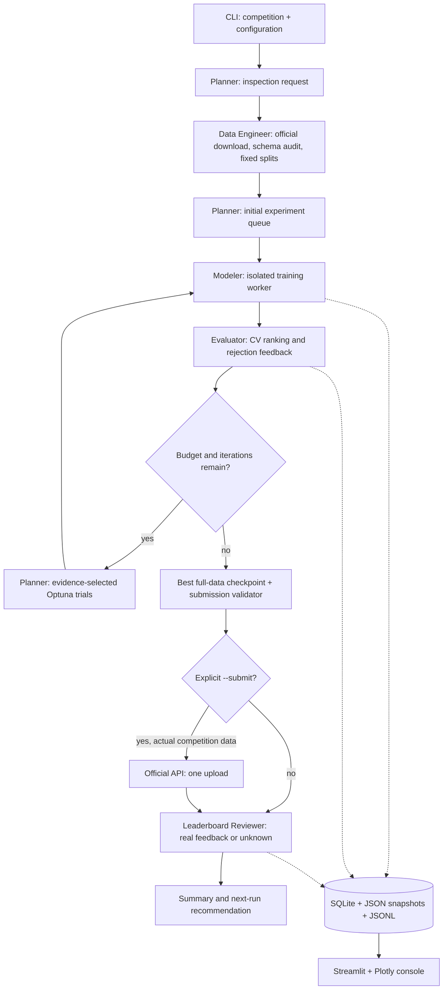

# Architecture and execution contracts

The CLI defaults to `agentic`, using `configs/agentic.yaml`, an LLM coordinator and specialist action/observation sessions. Configure a live or local provider before running. `deterministic` retains the existing state machine for compatibility and must be selected explicitly for offline CSV workflows; disable provider requests separately. Both modes execute trusted Python tools and numerical workers; model text never trains a model or establishes a score. See [agentic setup](agentic-usage.md) and [offline setup](offline-baselines.md).

## Agentic scheduler

`orchestration/swarm.py` is the sole owner of shared state, SQLite writes and reservations.
`agents/swarm.py` provides distinct versioned prompts. `schemas/actions.py` defines
delegation, tool, dependency-wait and finish messages. `tools/swarm_tools.py` binds typed
arguments, per-role permissions, bounds and opaque references to reusable numerical tools.
The provider-neutral `ActionProvider` interface supports compatible JSON envelopes and
native function calling through the existing configured endpoint/model.
Each role receives a narrowed schema of permitted action kinds, recipients and tool
names in both native parameters and JSON context. The full v1 protocol remains the
persisted action format; trusted runtime permission checks remain authoritative.
Unknown discriminator values are rejected with safe concrete repair instructions,
never coerced into operations. Prediction generation, serialized validation and a
specialist finish are distinct actions; only terminal runtime policy can upload.

The coordinator chooses tasks and dependencies, sees observations after each round, and
can revisit specialists. Ready specialist calls run concurrently with immutable scoped
JSON contexts. Ready experiments run in independent processes after the owner reserves
slots; their CPU allocations sum to no more than `n_jobs`. Workers return results to the
owner. No specialist can write state, reserve counters, select a winner or authorize an
upload. There is no agentic baseline/tuning/ensemble/confirmation queue policy.

Coordinator context contains durable `progress` receipts for the current measured
evaluation, generated predictions and serialized validation, in addition to recent
observations. Task goals/dependencies and finish blockers remain visible. Ready tasks
are served by least-used turn count; an explicit coordinator wait or queued finish
lets existing specialists run without extra coordinator calls. A finish is a barrier:
it drains outstanding work before verifying artifacts and recording completion. A
dependency graph with no runnable work returns a structured deadlock observation.

Equivalent delegations with the same parent, goal, dependencies, evidence and measured
revision share one task; new aliases retain their own action IDs and source references.
Unchanged evaluation/prediction/validation requests can reuse executed results across
tasks after checking live dataset fingerprints and artifact hashes. Keys exclude task
names and include relevant scientific inputs. A changed lineage or measurement starts
new work. Training and external feedback/upload effects are never served from this
reuse mechanism. The LLM still chooses experiments, dependencies and whether to finish.

Each accepted action has a stable ID and persisted status. The scheduler validates role,
schema, dependencies, lineage, parameter bounds, artifact hashes and resources. Local
receipts bridge commits; reserved workers with completed matching result files are
adopted on recovery. Missing results consume failed/uncertain attempts. Upload intent
is separately persisted before the single external attempt. Ambiguous effects cannot
be promised exactly once and are never silently replayed.

LLM latency counts against the resume-aware wall deadline. Input/output token allowances
and request/turn slots are charged before concurrent dispatch. Network operations and
numerical training/prediction use bounded execution; cancellation terminates subprocesses.
LLM HTTP transports run in killable child processes with hard total deadlines and no shared-state write capability. Provider
failure and exhausted budgets yield explicit incomplete checkpoints. Old snapshots lacking
mode/session fields remain deterministic; changing their mode is rejected.
Older agentic records without reuse keys execute normally on their next request;
completed IDs and artifacts are preserved. Final CLI provider diagnostics must match
the current termination reason; historical errors remain in persisted usage history.

Only aggregate evidence and opaque IDs are sent remotely. Validation changes create
separate comparison lineages. Terminal confirmation cannot feed tuning. Final predictions
come from the measured eligible winner's full-data checkpoint and serialized validation.
Feedback cannot enter selection, and all uploads still require explicit human authority.
See [usage, limits and recovery details](agentic-usage.md) and
[generated v1 contracts](contracts/swarm-v1/actions.schema.json).

## Deterministic compatibility architecture

The following describes the retained legacy engine, including its fixed search policy
and optional initial model-ordering advice. These scheduling defaults do not apply to
agentic sessions.

## Boundaries

`schemas/` defines validated configuration, queue entries, experiments, decisions and shared state. `agents/` contains policy and specialization. `tools/` implements external Kaggle access, data inspection, metric computation and training. `ml/` contains transformations, model factories and a worker entry point. `storage/` owns persistence. `orchestration/` handles transitions, budgets and recovery. `dashboard/` reads the same store as the CLI.

Both modes use primary CV to compare eligible experiments. Independent pipelines support CatBoost native categories alongside scaled linear and unscaled tree encodings. Each experiment records its training objective and preprocessing contract. Confirmations use a second seed, are excluded from primary ranking and never trigger more tuning. Group/time profiles retain structural splits and skip random confirmation. The evaluator reports stability and aggregate OOF error slices. LLM planning cautions remain separate from measured execution warnings.

The agentic scheduler follows LLM-selected actions within its eight-experiment ceiling, without a fixed queue. The deterministic planner reserves optional ensemble/confirmation work within its twelve-experiment default and normally schedules five baselines, four tuning trials, one ensemble and two confirmations. Its Optuna policy explores leading families before concentrating on the winner. Failed training attempts consume budget and do not enter ranking in either mode. See [experiment protocol](experiments.md) for shared scientific contracts and mode-specific scheduling.

## State and recovery

The deterministic engine uses phases `initialized → data_prepared → planned → training → evaluating → submission_ready → [submitting → reviewing] → finished`. Agentic execution additionally persists sessions, action/dependency status and termination reasons. SQLite is the authoritative checkpoint; `state.json` mirrors it atomically. Individual result files and models use per-experiment directories.

Resume verifies SHA-256 dataset fingerprints, reconstructs identical folds and skips recorded experiment IDs. The deterministic engine can retrain an interrupted queued experiment. Agentic recovery adopts matching completed worker results; a reserved attempt without a usable result remains failed/uncertain and consumes its slot. An exclusive run lock prevents concurrent resumes. After a hard process kill, inspect the PID in `.running.lock` and remove that exact file only after confirming the old runner and its workers have stopped.

Submission intent is persisted **before** uploading. An ambiguous or interrupted request is never retried. `refresh` reconciles matching submission IDs or the unique run description. Do not delete submission history to force retries. Review the Kaggle website when an outcome is uncertain.

## Resource limits

In deterministic mode, the Planner consumes the Reviewer's public-feedback discrepancy report and saves `next_run_plan.json`, with validation-audit priorities, suggested profile overrides and remaining budgets. Refresh can update this deferred plan. The agentic team does not reconvene after upload; feedback remains read-only and a new run is required for subsequent research.

`max_experiments`, `max_iterations`, `max_seconds`, `experiment_timeout`, `n_jobs`, `max_rows`, `max_features` and `max_dense_cells` bound work. Agentic execution also caps LLM requests, tokens, turns and concurrency. Numerical workers receive thread caps and run in independent processes: sequentially in the deterministic engine, or concurrently within the total CPU allocation in the agentic scheduler. Timeouts terminate workers, including model training threads. No GPU or distributed workers are used. Wall budgets persist across resumes; agentic LLM latency counts against the deadline. External calls, reporting and cleanup have bounded execution and may extend total wall time. The memory guard estimates dense encoded cells; it is not an OS-enforced RSS limit.

## Logging and artifacts

CLI runs report the active agent, experiment, remaining budget, fold scores and refit
progress. A heartbeat appears every ten seconds during worker startup or long training.
`resume` and `submit` use the same live reporting; `refresh` reports reviewer activity.

Each run writes to `artifacts/runs/<run-id>/`:

| Artifact | Purpose |
|---|---|
| `progress.log` | Timestamped CLI activity |
| `decisions.jsonl`, `state.json`, `summary.json` | Agent decision summaries, saved state and final result |
| `experiments/<experiment-id>/` | Model checkpoint, CV results, worker logs, structured progress and available OOF/importance outputs |
| `evaluation.json`, comparison and EDA HTML | Measured rankings, diagnostics and dataset inspection |
| `submissions/submission.csv` and validation report | Serialized predictions and output checks |

`artifacts/metadata.sqlite` serves history, recovery and the dashboard. Snapshots retain
configuration, seeds, package versions and dataset fingerprints. Agent decision summaries
and tool results are logged; raw LLM responses, credentials and raw worker stdout are not
streamed to the console. Detailed library output stays in each worker's `worker.log`.

Ordinary generated runs remain ignored by Git. The
[recorded Home Data package](../demo/home-data-for-ml-course-8ed561cbed5e/README.md)
has a scoped exception for its six checkpoints and shareable evidence. Its guide explains
hash verification and the seven local-only label outputs excluded from a checkout.

## Security and privacy

Secrets are environment values or official Kaggle configuration, never state fields. Agentic contexts use aggregate evidence and opaque references, excluding raw rows, column/class names, credentials and local paths. The legacy optional planner request uses schema names and target aggregates; use a deterministic provider to disable that request, or a local endpoint when appropriate. LLM output is Pydantic-validated, model names are allowlisted, and proposals cannot override upload authorization or scientific/resource safeguards. Kaggle read retries are bounded and do not retry permission/quota failures. Writes are single-attempt. Archive paths and extracted sizes are checked.

LLM failures have typed, controlled diagnostics for HTTP errors, network failures, completion envelopes and advice validation. Diagnostics exclude raw response/request bodies, headers, exception strings and invalid field values. They are saved with the planner's decisions and metadata. An explicit `llm-check` command makes one synthetic planning request; ordinary offline workflow tests never use a developer's real provider configuration. See [troubleshooting](llm-troubleshooting.md).

Run this dashboard as a trusted local application. It can display generated HTML and offer local artifact downloads; it has no authentication layer. Joblib checkpoints are Python objects and must only be loaded from trusted local runs.
