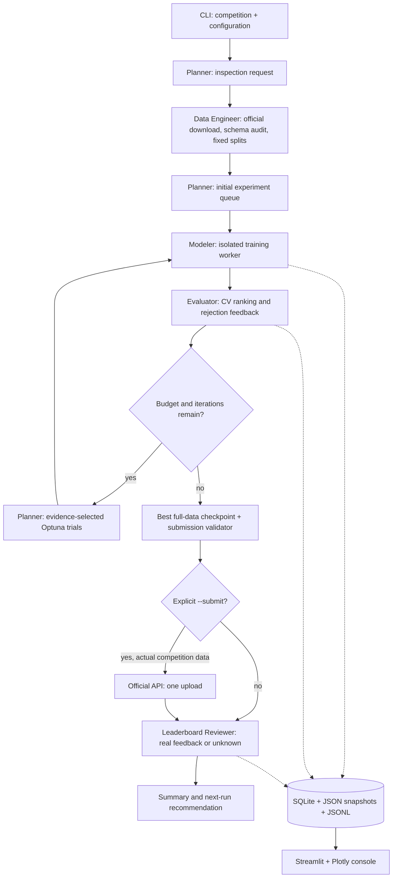

# Architecture and execution contracts

KaggleSlayer is a local, single-runner ML service implemented as a typed, checkpointed state machine. Independent agents have different tools and exchange bounded, structured reports through `RunState`. They never execute generated source code. An LLM can reorder approved experiment families and explain strategy; measured evaluation determines which family receives optimization trials.

## Boundaries

`schemas/` defines validated configuration, queue entries, experiments, decisions and shared state. `agents/` contains policy and specialization. `tools/` implements external Kaggle access, data inspection, metric computation and training. `ml/` contains transformations, model factories and a worker entry point. `storage/` owns persistence. `orchestration/` handles transitions, budgets and recovery. `dashboard/` reads the same store as the CLI.

The planner reserves optional ensemble/confirmation work inside the total experiment budget. Primary CV compares baselines, trials across leading families, and a fixed ensemble. Independent member pipelines support CatBoost native categories alongside scaled linear and unscaled tree encodings. Each experiment records its training objective and preprocessing contract. Finalist confirmations use a persisted frozen queue and a second seed; their role excludes them from primary ranking and their results never trigger more tuning. Group/time profiles retain their structural splits and skip random confirmation. The evaluator reports stability and aggregate OOF error slices. LLM planning cautions are retained as planning advice rather than measured execution warnings.

The default loop runs three independent families followed by two seeded Optuna trials. The evaluator returns the best eligible model, train/CV gap, rejected candidates and a specific next-experiment recommendation. The planner consumes that feedback and asks Optuna for bounded parameters in the best family. Failed trials consume the experiment budget and do not enter the ranking. There is no guarantee that tuning improves a score.

## State and recovery

Phases: `initialized → data_prepared → planned → training → evaluating → submission_ready → [submitting → reviewing] → finished`. Status is separately `running`, `completed`, `failed`, or `interrupted`. The engine saves before each major phase and after each experiment. SQLite is the authoritative checkpoint; `state.json` mirrors it atomically. Individual result files and models use per-experiment directories.

Resume verifies SHA-256 dataset fingerprints, reconstructs identical folds and skips recorded experiment IDs. A worker interrupted before its experiment checkpoint is safely retrained. An exclusive run lock prevents two runners from resuming the same run concurrently. After a hard process kill, inspect the PID in `.running.lock` and remove that exact file only after confirming the old runner has stopped.

Submission intent is persisted **before** uploading. An ambiguous or interrupted request is never retried. `refresh` reconciles matching submission IDs or the unique run description. Do not delete submission history to force retries. Review the Kaggle website when an outcome is uncertain.

## Resource limits

After public feedback arrives, the Planner consumes the Reviewer's discrepancy report and saves `next_run_plan.json`. This deferred plan includes validation-audit priorities, suggested profile overrides and remaining budgets. It does not trigger more uploads or override a completed run's limits. Refresh can update the plan with new read-only feedback.

`max_experiments`, `max_iterations`, `max_seconds`, `experiment_timeout`, `n_jobs`, `max_rows`, `max_features` and `max_dense_cells` bound work. Workers receive thread caps and run sequentially in independent processes. A subprocess timeout terminates the worker, including model training threads. No GPU or distributed workers are used. The global wall budget is charged across resumes and checked before scheduling work; external API calls, reporting and cleanup have their own timeouts/retry bounds and may extend total wall time. The memory guard estimates dense encoded cells; it is not an OS-enforced RSS limit.

## Security and privacy

Secrets are environment values or official Kaggle configuration, never state fields. The LLM receives schema and aggregate quality information, not CSV rows. Schema/column names may still be sensitive; use deterministic/local mode for private datasets. LLM output is Pydantic-validated, model names are allowlisted, and proposals cannot alter metrics, budgets or upload authorization. Kaggle read retries are bounded and do not retry permission/quota failures. Writes are single-attempt. Archive paths and extracted sizes are checked.

LLM failures have typed, controlled diagnostics for HTTP errors, network failures, completion envelopes and advice validation. Diagnostics exclude raw response/request bodies, headers, exception strings and invalid field values. They are saved with the planner's decisions and metadata. An explicit `llm-check` command makes one synthetic planning request; ordinary offline workflow tests never use a developer's real provider configuration. See [troubleshooting](llm-troubleshooting.md).

Run this dashboard as a trusted local application. It can display generated HTML and offer local artifact downloads; it has no authentication layer. Joblib checkpoints are Python objects and must only be loaded from trusted local runs.
