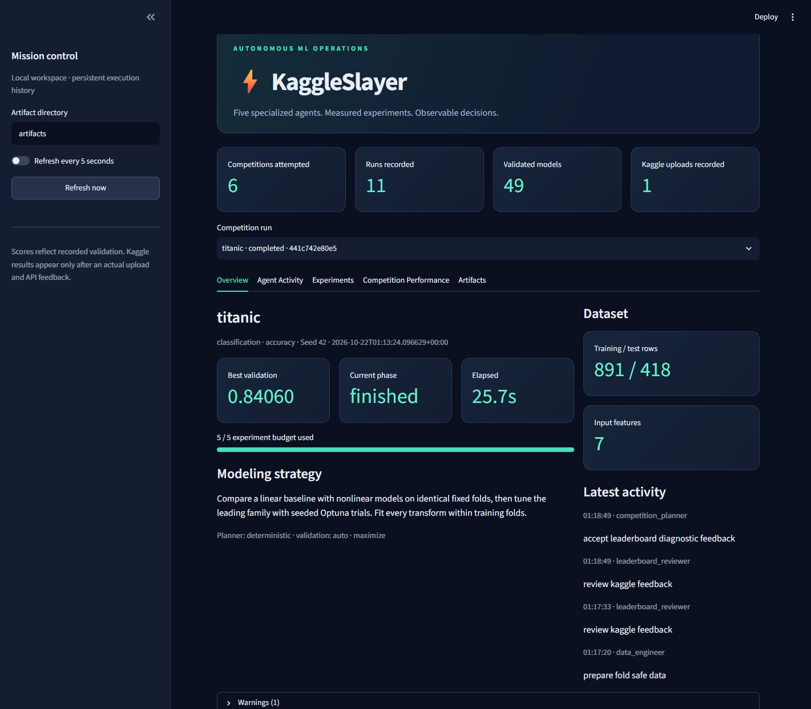
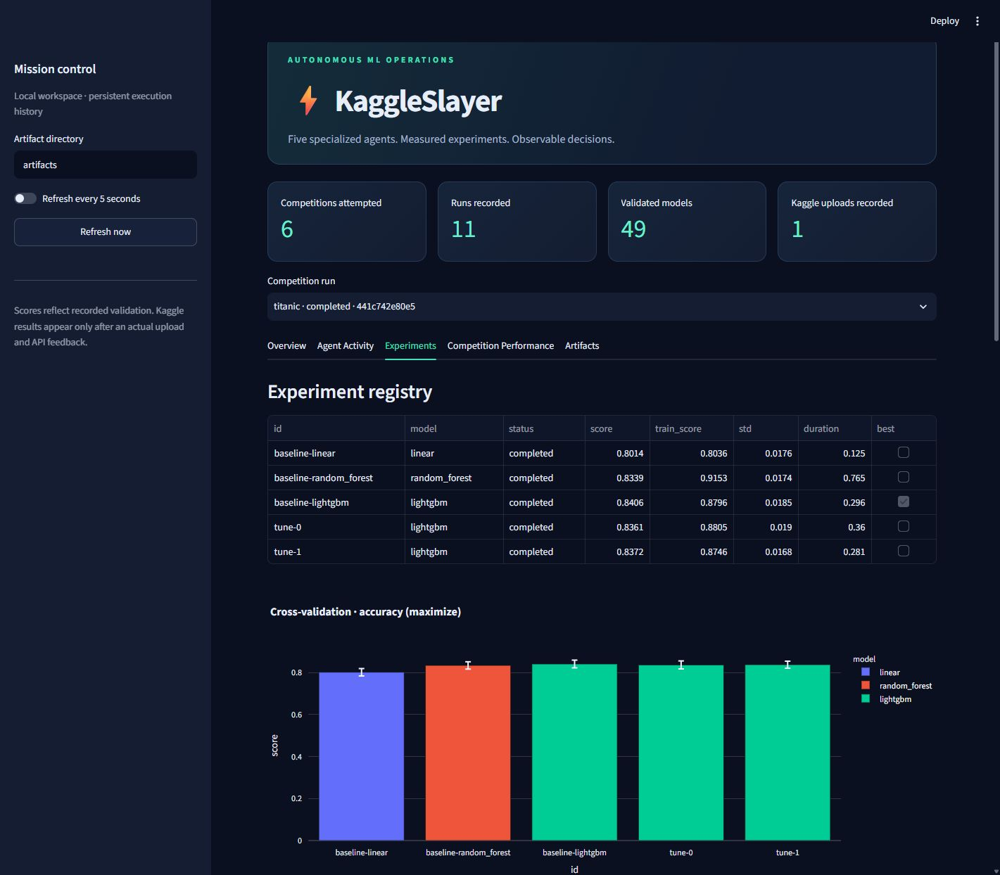
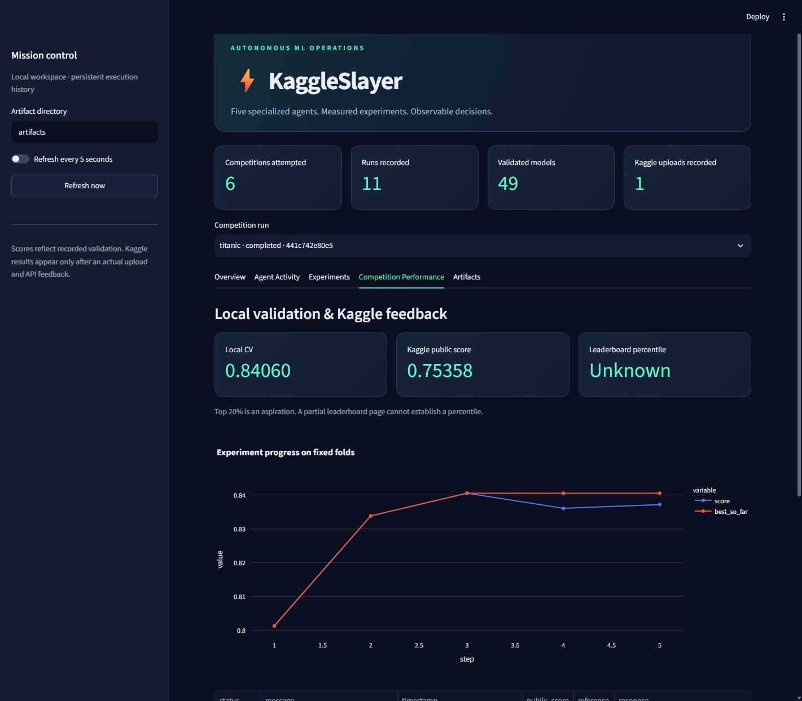

# Executed evidence

Executed on **October 21, 2026 (America/Sao_Paulo)** using Python 3.11.15 and the committed uv dependency resolution. Stored UTC timestamps can fall on October 22. These are measured runs and screenshots, not mock dashboard values.

## Verification

- Full offline suite: **68 tests passed**; see [console log](tests.log) and [JUnit XML](test-results.xml). Default tests do not contact Kaggle. Optional XGBoost and CatBoost were installed and exercised for both classification and regression.
- Six upstream LightGBM deprecation warnings concern `eval_set`; they did not fail training or tests. The locked supported dependency version accepts this API.
- Ruff checks and formatting passed for source, tests, dashboard, scripts and examples.
- Built wheel and isolated installation smoke test passed for Titanic and House Prices profile discovery outside the repository: [actual log](wheel-smoke.log).
- Live Streamlit UI was inspected in the browser. Actual screenshots appear below. Docker and remote GitHub Actions execution were not tested here.

## Official Titanic: complete workflow and actual upload

Run: `titanic-441c742e80e5`. The official Kaggle API authenticated with existing user credentials, retrieved competition metadata and downloaded the original files. The workflow used 891 training rows, five stratified folds, three model families and two Optuna trials. It produced and round-trip validated all 418 test predictions.

| Experiment | Family | Mean CV accuracy | Fold standard deviation |
|---|---|---:|---:|
| baseline-linear | Logistic regression | 0.801375 | 0.017620 |
| baseline-random_forest | Random Forest | 0.833877 | 0.017407 |
| baseline-lightgbm | LightGBM | **0.840600** | 0.018530 |
| tune-0 | LightGBM | 0.836125 | 0.019048 |
| tune-1 | LightGBM | 0.837242 | 0.016833 |

The baseline LightGBM won; tuning did not improve it. After verifying existing competition participation and zero submissions used that UTC day against a quota of ten, the saved-file submit command uploaded **once**. The official API returned:

- Submission reference: **57504220**.
- Status: **COMPLETE**.
- Actual Kaggle public accuracy: **0.75358**.
- Local CV minus public score: **0.087020**; the reviewer flagged unexpected degradation.
- Rank and top-20% achievement: **not established**. Account rank from competition metadata can reflect earlier user submissions and is not attributed to this run.

Evidence: [training log](official-titanic.log), [actual submission response](titanic-submission.log), [feedback refresh](titanic-feedback.log), [experiment records](titanic/experiments.csv), [decision trace](titanic/decisions.jsonl), [evaluation](titanic/evaluation.json), [submission validation](titanic/validation.json), [comparison chart](titanic/comparison.html), and [planner follow-up](titanic/next_run_plan.json).

The planner proposes reviewing duplicate/passenger groups and comparing Ticket-group CV before further regularization work. The proposed plan is **not an executed experiment**. Both this run's experiment and submission budgets are spent, and no follow-up upload occurred. The actual CSV/checkpoints remain in the local ignored `artifacts/runs/titanic-441c742e80e5/` directory.

The performance gap is a material limitation. The system demonstrates the complete workflow, not a top-20% result or a guarantee of competitive generalization.

## Official House Prices: configuration portability

Run: `house-prices-advanced-regression-techniques-da4cc92ba57f`. The same source code downloaded official data and trained on 1,460 rows, evaluated five folds and generated 1,459 validated test predictions.

| Experiment | Family | Mean natural-log RMSE |
|---|---|---:|
| baseline-linear | Ridge | 0.152141 |
| baseline-random_forest | Random Forest | 0.145401 |
| baseline-lightgbm | LightGBM | 0.131069 |
| tune-0 | LightGBM | 0.133810 |
| tune-1 | LightGBM | **0.131055** |

The tuned model won by a very small margin. The evaluator also recorded a large training/CV gap; this warning remains visible. **House Prices was not uploaded**, so it has no new public score or rank.

Evidence: [actual console log](official-house-prices.log), [experiments](house-prices-advanced-regression-techniques/experiments.csv), [decisions](house-prices-advanced-regression-techniques/decisions.jsonl), [evaluation](house-prices-advanced-regression-techniques/evaluation.json), [submission validation](house-prices-advanced-regression-techniques/validation.json), and [chart](house-prices-advanced-regression-techniques/comparison.html).

## Public dataset and synthetic demonstrations

| Run | Provenance | Experiments | Best measured validation |
|---|---|---:|---:|
| fixture-classification-7a67a716e480 | Generated, Titanic-shaped CSVs | 5 | 0.783333 accuracy |
| fixture-regression-af6047fe1d22 | Generated, house-price-shaped CSVs | 5 | 0.149609 RMSLE |
| fixture-classification-ensemble-75c3b1443646 | Generated; includes a CV-tested voting model | 5 | 0.783333 accuracy |
| public-titanic-demo-624571a6b056 | Real public example observations, local split | 5 | 0.823047 accuracy |

The ensemble measured 0.766667 accuracy and was rejected in favor of the tuned Random Forest. This is evidence that the evaluator can retain a stronger single model rather than selecting added complexity automatically.

The public Titanic demo used the [seaborn example data repository](https://github.com/mwaskom/seaborn-data), with a recorded source SHA-256. Its 712-row training portion produced 0.823047 five-fold accuracy; its untouched 179-row local holdout produced **0.782123 accuracy**, evaluated after model selection. This holdout is not the official Kaggle test set and its score never entered planning. See [holdout evidence](public-titanic-demo/public_holdout_evidence.json) and [provenance](public-titanic-demo/provenance.json).

Synthetic example predictions, traces and reports are included under [classification](fixture-classification/), [regression](fixture-regression/) and [ensemble](fixture-classification-ensemble/). No synthetic/public-demo run was submitted to Kaggle. The engine refuses such uploads.

## Dashboard proof

These images were captured from the actual running Streamlit app reading SQLite. Counters include earlier real local runs and failed attempts, so they can differ from the six curated runs in [index.json](index.json).

## Reproducing and handling data

Use the commands in [the walkthrough](../docs/demo.md) and [reproducibility instructions](../docs/reproducibility.md). `uv run python scripts/export_evidence.py` exports marked synthetic/public runs; `--official-run RUN_ID` explicitly includes aggregate official-run evidence. It excludes original competition rows, official prediction CSVs and model binaries. Live dashboard records remain in `artifacts/metadata.sqlite`.

Charts in this curated directory use the Plotly CDN to keep Git artifacts small. The corresponding run directories contain standalone HTML plots with Plotly embedded. Credentials and raw Kaggle datasets are excluded from version control.
